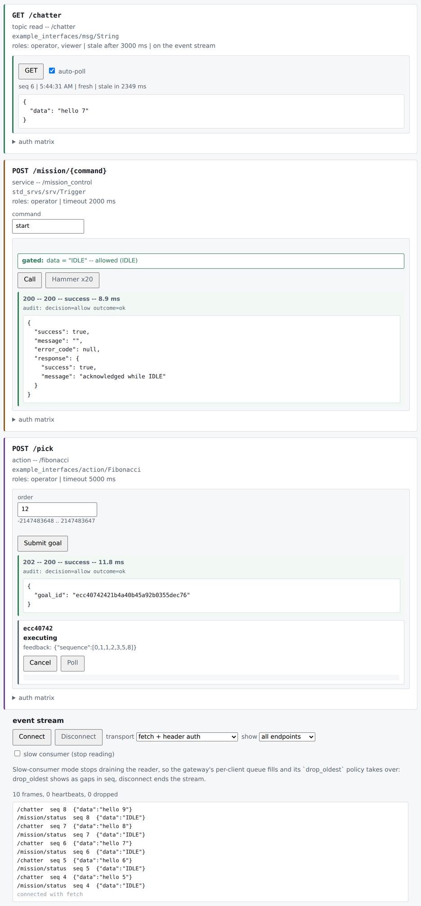

# ros2_http_gateway

[](https://github.com/justagist/ros2_http_gateway/actions/workflows/ci.yml)
[](https://www.python.org/downloads/)
[](#supported-versions)
[](LICENSE)
[](pyproject.toml)
[](pyproject.toml)

**One YAML file decides exactly which ROS 2 topics, services and actions are reachable over
HTTP** -- with per-endpoint roles, state-based preconditions, audit logging, server-sent events
and a generated OpenAPI 3.1 document. Nothing is exposed unless you name it.

## What one config file gets you

Below is [`examples/demo.yaml`](examples/demo.yaml), trimmed. Serve it and the built-in console
renders itself from it -- forms, live tiles, gates, goal cards -- with no client code written:

```yaml
endpoints:
  /mission/status:                        # GET the newest sample, flagged stale after 3 s
    topic: /mission/state
    type: example_interfaces/msg/String
    roles: [viewer, operator]
    stale_after_ms: 3000

  /chatter/say:                           # POST publishes the body
    topic: /chatter
    type: example_interfaces/msg/String
    method: POST
    roles: [operator]

  /mission/{command}:                     # POST calls a service, gated on live state
    service: /mission_control
    type: std_srvs/srv/Trigger
    method: POST
    roles: [operator]
    timeout_ms: 2000
    preconditions:
      - state_endpoint: /mission/status
        field: data
        allow: { start: [IDLE], abort: [RUNNING], reset: ["*"] }

  /pick:                                  # POST submits a goal; status, feedback and cancel follow
    action: /fibonacci
    type: example_interfaces/action/Fibonacci
    roles: [operator]

auth:
  tokens:
    - token_sha256: "61112491d046c3f6f8ab801f170d9b2d0c734a17ceff60dee92123fb507cfc3f"
      user: demo-operator
      roles: [operator]

sse: { path: /events, include: [/mission/status, /chatter] }
http: { bind: 127.0.0.1, port: 8080, base_path: /api/v1, console: true }
```



Reading down that screenshot: a topic tile counting down to its staleness bound; a service showing
the live state it is gated on (`data = "IDLE" -- allowed`) beside the button, with the audit line
the call produced; a goal card mid-flight with feedback; and the event stream, with its two
transports and a slow-consumer switch. [Full page](https://raw.githubusercontent.com/justagist/ros2_http_gateway/main/docs/console-full.png).

## Try it in two terminals

```bash
# terminal 1 -- a demo node: mission state cycling IDLE/RUNNING, a 2 Hz topic, a service, an action
ros2 run ros2_http_gateway ros2-http-gateway-demo

# terminal 2
ros2-http-gateway examples/demo.yaml
```

Open <http://127.0.0.1:8080/api/v1/console> and paste `demo-operator-token`. Or stay in the shell:

```bash
curl -H 'Authorization: Bearer demo-operator-token' \
  http://127.0.0.1:8080/api/v1/mission/status
```

Paste `demo-viewer-token` instead and the write, the service and the action disappear from the
page: the console is built from a manifest filtered to the token's roles. The service is gated on
live mission state, so `POST /api/v1/mission/start` flips between success and
`PRECONDITION_FAILED` every eight seconds as the demo cycles.

Interactive API docs are at `/api/v1/docs`, the OpenAPI document at `/api/v1/openapi.json`.

## Validate a config without starting anything

```bash
ros2-http-gateway --check examples/demo.yaml                     # exit 0/1
ros2-http-gateway --check --dump-openapi api.json examples/demo.yaml
```

`--check` resolves every interface type, compiles every converter and checks every precondition
field against the real message definition, then prints one line per endpoint. It needs no running
system when the config pins its types, which is what makes it usable as a CI gate; add `--online`
on the robot to verify those pinned types against the live graph too.

## Why not rosbridge

`rosbridge_suite` exposes the whole ROS graph over a WebSocket with, at best, a shared secret.
That is the right tool for a debugging UI on a bench, and the wrong tool for a machine that has to
pass a security review.

| | rosbridge | ros2_http_gateway |
|---|---|---|
| Exposed surface | whole graph, discovered at runtime | only what the config names |
| Transport | WebSocket, custom protocol | plain HTTP + SSE, described in OpenAPI |
| Auth | optional shared secret | per-token identity, per-endpoint roles |
| Authorisation | none | roles plus state-based preconditions |
| Audit | none | one JSON line per authenticated request |

## Install

```bash
pip install ros2-http-gateway
```

`rclpy` is deliberately not a pip dependency; it comes from your sourced ROS 2 environment.
`--help` and `--version` work without one, everything else needs
`source /opt/ros/$ROS_DISTRO/setup.bash`.

On a Debian-managed Python -- which is what a ROS container gives you -- install into a virtualenv
rather than fighting PEP 668. Upgrading pip inside it matters on Humble, where pip 22 installs an
editable package with `setup.py develop` and so ignores `pyproject.toml` metadata entirely:

```bash
python3 -m venv --system-site-packages .venv
.venv/bin/python -m pip install --upgrade pip
.venv/bin/python -m pip install ros2-http-gateway
```

In a colcon workspace:

```bash
cd ~/ws/src && git clone https://github.com/justagist/ros2_http_gateway.git
cd ~/ws && colcon build --packages-select ros2_http_gateway
source install/setup.bash
ros2 run ros2_http_gateway ros2-http-gateway --help
```

## Documentation

| | |
|---|---|
| [docs/configuration.md](docs/configuration.md) | every config key, and the rule each one enforces |
| [docs/protocol.md](docs/protocol.md) | the wire protocol: bodies, status codes, streams, audit |
| [docs/security.md](docs/security.md) | the security model and its known gaps |
| [docs/deployment.md](docs/deployment.md) | TLS, and several cells behind one nginx |
| [docs/decisions.md](docs/decisions.md) | settled questions, one line each, so they stay settled |
| [docs/release.md](docs/release.md) | how a release is cut |
| [bench/RESULTS.md](bench/RESULTS.md) | benchmark numbers, and how to reproduce them |
| [CHANGELOG.md](CHANGELOG.md) | what is real in each version |

## The test console

Off unless `http.console: true`, and a testing tool rather than an HMI: every widget maps to one
protocol feature, and there is no dashboard, chart or saved layout in it. Everything comes from
`<base>/console/manifest` and the schemas in the OpenAPI document, so no endpoint is hardcoded.

- A **token wallet** -- several labelled tokens, one active, switchable in place.
- An **auth matrix** per endpoint: fire as nobody, as a bad token, and as each saved token, then
  read the 401/401/403/2xx grid. Anything that is not a GET is probed with a body no converter
  accepts, so an authorised token shows 400 -- proof the roles passed, with nothing published,
  called or submitted.
- **Topic tiles** with the sample, its `seq` and stamp, and a countdown that visibly flips the tile
  when it expires. Manual GET or auto-poll.
- **Schema-driven forms** for writes and services. Flat fields and one nesting level get widgets;
  arrays and anything deeper fall back to a raw JSON editor validated in the browser against the
  same schema the gateway will apply.
- **The protocol taxonomy, visibly**: a 4xx that never reached ROS, a 503 capacity limit, a 200
  refused by a state gate, a 200 carrying a ROS-side error, and a plain success all look different.
- **Goal cards**: status by polling, feedback over the goal's own stream, cancel, the result, a
  countdown to `result_ttl_s`, then the 404 once evicted. Several at once.
- **An event-stream panel**: per-endpoint filter, faint heartbeats, a seq-gap detector, and a
  transport toggle between `fetch` with header auth and `EventSource` with the query token -- which
  also makes visible that `EventSource` cannot show you a heartbeat.
- **An audit hint** under every response: the decision, outcome and reason that request wrote to
  the audit log.

## Supported versions

Python 3.10+, ROS 2 Humble, Jazzy, Kilted, Lyrical and Rolling. Humble is the feature floor:
`ros.executor: auto` uses `rclpy.experimental.EventsExecutor` where it exists and falls back to
`MultiThreadedExecutor` where it does not.

One caveat, measured rather than assumed: on Humble a 1 kHz topic costs about 80% of a core,
against under 5% on Jazzy and newer. That is rclpy's per-message dispatch on that distro -- an idle
gateway still costs ~1%, and the cost is paid before any code here runs -- so nothing here can
avoid it. Everything works on Humble; if you intend to stream kilohertz topics, budget for it or
use a newer distro.

## Design in one picture

```
+- rclpy thread(s) -----------------+      +- asyncio thread -----------------+
| MultiThreadedExecutor / Events    |      | Starlette + uvicorn + uvloop     |
| raw=True subscriptions (CDR)      |      | auth -> policy -> handler        |
|   -> atomic ref swap into caches  |=====>| SSE broadcaster (encode once,    |
| service clients / action clients  |queue |   fan out bytes)                 |
+-----------------------------------+      +----------------------------------+
```

ROS callbacks never run on the asyncio loop, and the loop never blocks on ROS. All expensive work
-- config validation, type resolution, converter code generation, route and policy tables, the
OpenAPI document -- happens at startup, so a request is lookups and precompiled code.

## Performance

Measured with `python3 bench/run.py` on a 24-core i7-14650HX, Jazzy, `rmw_fastrtps_cpp`. Full
table and caveats in [bench/RESULTS.md](bench/RESULTS.md).

| | |
|---|---|
| Cached topic `GET` | 11.8k req/s, p99 3.8 ms |
| Service round trip | p50 0.91 ms, p99 1.65 ms |
| State precondition | +10 us end to end, 1.1 us p99 measured alone |
| `msg -> dict` (`sensor_msgs/Imu`) | 1.2 us, 44x `rosidl_runtime_py` |
| Event stream, 32 clients | 6.2k events/s for 18.7% of one core |
| Idle, no traffic | 0.5% of one core |

The stream row is the point of "encode once, fan out bytes": 32 clients cost 1.7x the CPU of one,
because a sample is converted and framed once and the same `bytes` object goes to every queue.
Throughput is a floor -- the load driver shares the machine with the gateway.

## JSON representation

- `uint8[]` and `byte[]` become base64 strings. Large-blob topics -- images, point clouds -- are
  out of scope: this is a JSON gateway, not a data plane.
- `int64`/`uint64` become JSON strings by default (`int64_as_string`), because values above 2^53
  do not survive a JavaScript `number`.
- Numeric arrays serialise straight from numpy, with no intermediate list. Numeric sequences,
  which rclpy hands over as `array.array`, become a zero-copy numpy view once they are long enough
  for that to pay (measured crossover: 64 elements).

## Status codes

4xx means the request never reached ROS: 401/403 auth, 400 a malformed body or an out-of-range
value, 404 an unknown route or goal. 503 means a capacity limit was hit. 200 means it did reach
ROS, and `error_code` carries the outcome -- because "the service timed out" is a result, not a
protocol error. One envelope shape for all of them; the detail is in
[docs/protocol.md](docs/protocol.md).

## Security model

Deny by default: an endpoint that is not in the config does not exist, and there is no discovery
path that could add one at runtime.

- **Tokens** are compared as SHA-256 digests with `hmac.compare_digest`, and every configured
  digest is compared even after a match, so neither the token nor its position in the file can be
  timed. Prefer `token_sha256:`; a plaintext `token:` is hashed on load, warned about, and refused
  outright if the config file is world-readable.
- **Roles** are per endpoint. Authentication and the role check both run before any state
  precondition, so a caller who may not use an endpoint learns nothing about the robot from being
  refused.
- **Roles gate action, not description.** An authenticated caller can already enumerate the routes
  by asking -- unknown paths answer 404, forbidden ones 403 -- so the OpenAPI document is served
  whole to any of them. The console manifest does filter by role, but that is defence in depth, not
  a boundary.
- **Audit**: one JSON line per authenticated request -- who, what, the decision and its reason, the
  outcome, the latency. Never tokens, never bodies, never the query string.
- **No TLS, no rate limit, no body size limit.** The gateway binds localhost unless told otherwise;
  all three belong in a reverse proxy. See [docs/deployment.md](docs/deployment.md).

Known gaps, and why, are in [docs/security.md](docs/security.md) -- including the one place a
credential may appear in a URL, and what that costs you.

## Licence

Apache-2.0. See [LICENSE](LICENSE).
